<div align="center">



<br>


**Rockstar Editor clips without leaving the server.**
`/grabar` opens a small panel that does not take your mouse: record, save or discard clips with one key while you keep playing.

[Features](#-features) · [Installation](#-installation) · [Configuration](#-configuration) · [Editing your clips](#-editing-your-clips) · [License](#-license)

</div>

---

## ✨ Features

<table>
<tr>
<td width="50%" valign="top">

### 🎬 Record while you play
The panel has no NUI focus: you keep moving, driving and shooting. A camera viewfinder shows the REC light and the clip time, read from the game itself (`IsRecording`).

### ⌨️ Rebindable keys
`7` record, `8` save, `9` discard, `0` editor. Every player can change them in Settings → Key Bindings → FiveM, and the panel shows the key they actually use.

</td>
<td width="50%" valign="top">

### 🔐 Who can use it
ACE `jvl_recorder.use`, a list of jobs (e.g. reporters) or everybody. Checked on the server.

### 📝 Log
Start / save / discard / editor in the database (`jvl_recorder_logs`, created on start) and optionally in a Discord webhook.

### 🌐 Any framework, two languages
Qbox, QBCore, ESX or standalone (auto-detected). Spanish / English from the player's GTA language.

</td>
</tr>
</table>

## 🚀 Installation

1. Put `jvl_recorder` in your resources and `ensure jvl_recorder` (after oxmysql if you keep the database log). It declares **no fxmanifest dependencies**.
2. Permission:
   ```cfg
   add_ace group.admin jvl_recorder.use allow
   ```
   Or set `Config.Permission.jobs` / `Config.Permission.everyone` in `config.lua`.
3. Optional Discord log (server side): `set jvl_recorder_webhook "https://discord.com/api/webhooks/..."`.

Optional: `oxmysql` (database log, turn it off with `Config.Log.database = false`), `jvl_notify` / `ox_lib` for notifications.

## ⚙️ Configuration

| Option | What it does |
|---|---|
| `Config.Command` | Command that opens / closes the panel (`grabar`) |
| `Config.Keys` | Default keys: panel, record, save, discard, editor (`''` = no default) |
| `Config.KeysOnlyWithPanel` | `true` = the keys only work while the panel is open |
| `Config.EditorButton` | Show the "open editor" key in the panel (press twice, it disconnects you) |
| `Config.Permission` | `everyone` and `jobs`, besides the ACE |
| `Config.Position` | Panel corner: `bottom-right`, `bottom-left`, `top-right`, `top-left` |
| `Config.Log.database` | Save the actions in `jvl_recorder_logs` |
| `Notify()` | Your notification system (examples for okok, QB, ESX, wasabi inside) |

## 🎞️ Editing your clips

Saved clips go to the Rockstar Editor. On servers with many streamed resources (maps, cars, props) FiveM can crash while it unloads them on the way to the editor, so the panel recommends:

1. Record and save your clips in the server.
2. Close FiveM and open it again.
3. Open the **Rockstar Editor** and edit there.

Clips with add-on content (cars, MLOs, props) may show missing models in the editor, because those files only exist while you are connected to the server.

## 📄 License

Released under the **MIT License** — free to use, modify and share, keeping the copyright notice. See [`LICENSE`](LICENSE).

© 2026 JVL MediaCode

---

<div align="center">

Made by **[JVL MediaCode](https://jvlmediacode.com)** · Jose M. Valenzuela · Meoqui, Chihuahua, México

<sub><a href="mailto:contacto@jvlmediacode.com">contacto@jvlmediacode.com</a> · <a href="https://discord.gg/m2spgxkPfj">Discord</a></sub>

</div>
